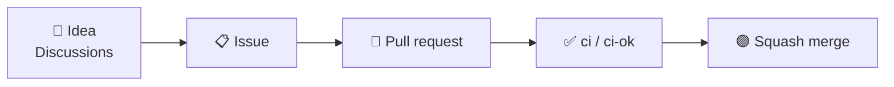

# Contributing

| Change | How |
| --- | --- |
| An idea | Start in [Discussions](https://github.com/SoulCraft-Org/star-compute/discussions/categories/ideas). An accepted idea becomes an issue |
| The plan | Edit [`docs/PLAN.md`](docs/PLAN.md) or the README in a pull request. Name the source and date of every figure |
| Every commit | Sign off with `git commit -s` ([DCO](https://developercertificate.org/)) |
| Every pull request | `ci / ci-ok` must pass: the voice lint over every Markdown file |
