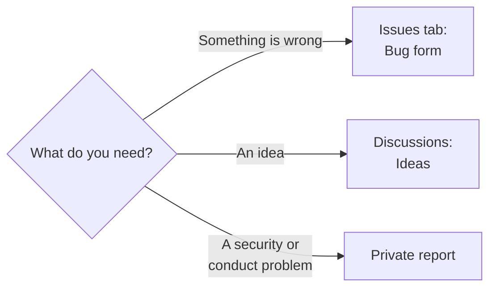

# Support

| Need | Where |
|---|---|
| Report a mistake | The Issues tab, **New issue**, the **Bug** form |
| Propose an idea | [Discussions, Ideas](https://github.com/SoulCraft-Org/star-compute/discussions/categories/ideas) |
| Ask a question | [Discussions, Q&A](https://github.com/SoulCraft-Org/star-compute/discussions/categories/q-a) |
| Report a security problem | [SECURITY.md](SECURITY.md), never a public issue |
| Report conduct | [CODE_OF_CONDUCT.md](CODE_OF_CONDUCT.md) |
| See the scores | [Quality and Process pages](https://soulcraft-org.github.io/star-compute/) |
